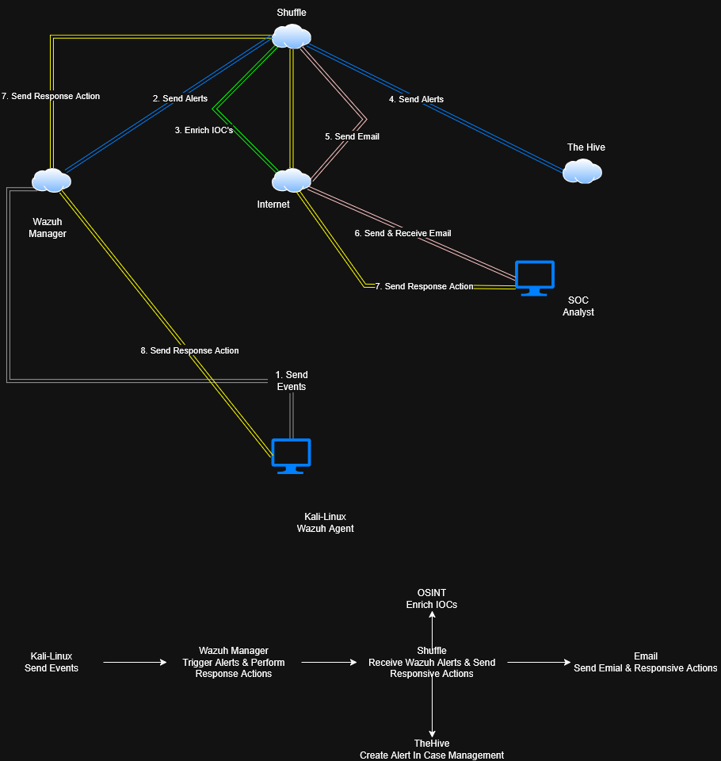
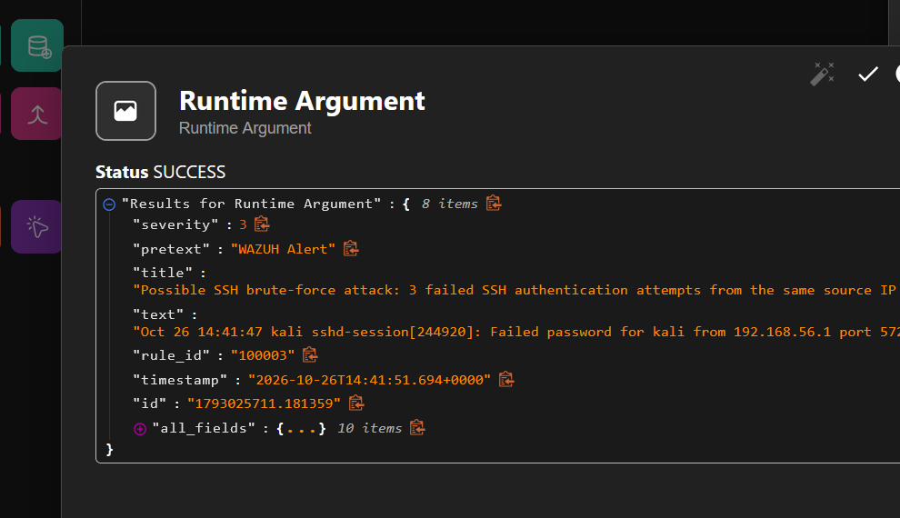
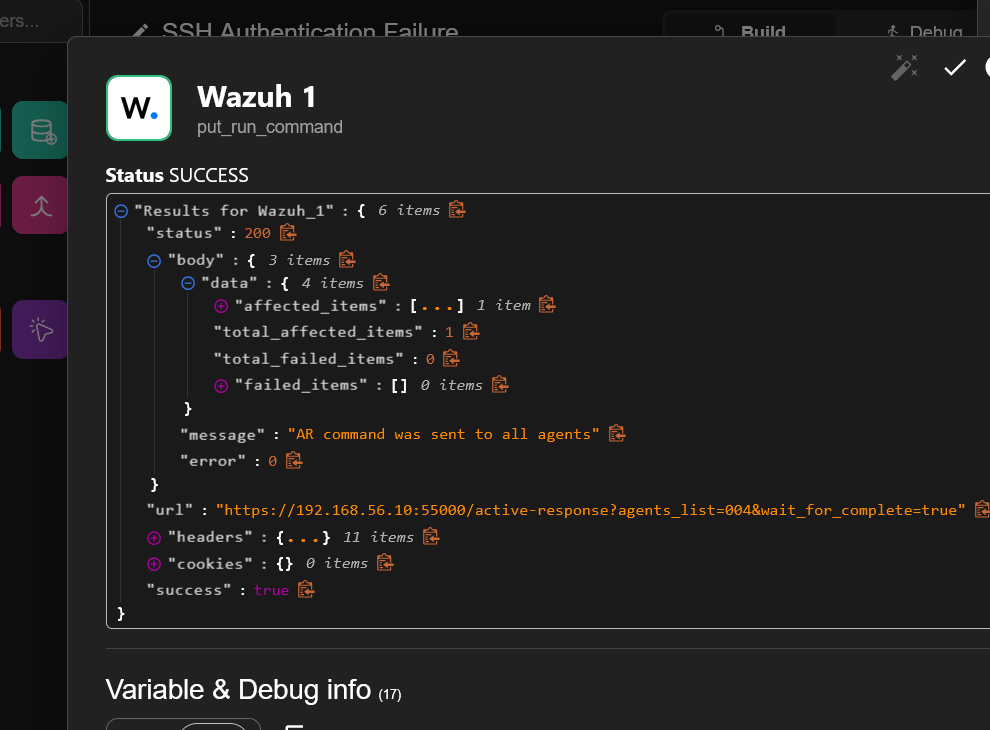
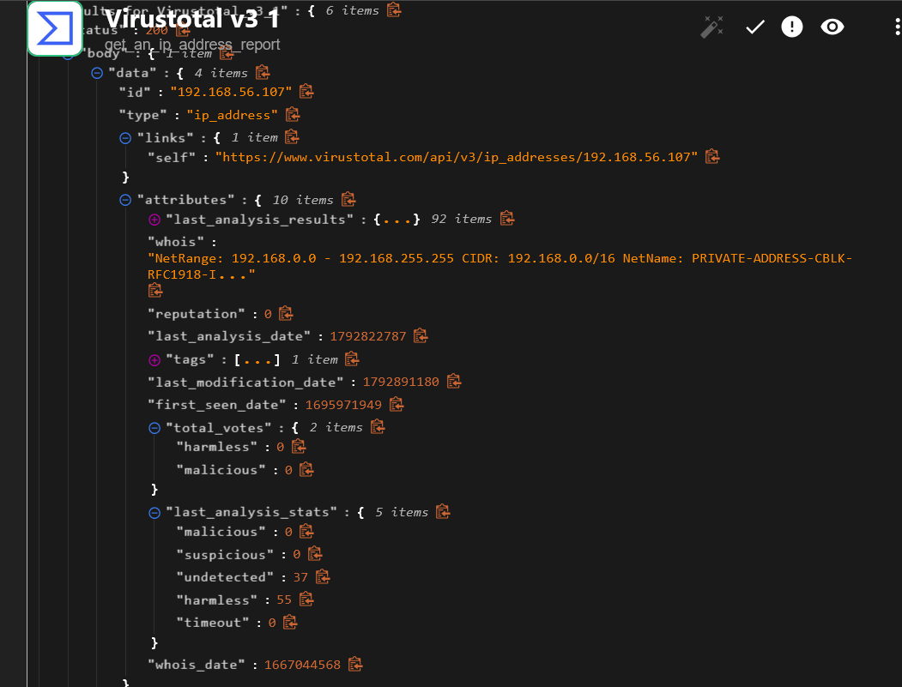

# SOC Alert Enrichment & Human-Approved Response Lab

A hands-on Security Operations Center (SOC) home lab that brings together **Wazuh**, **Shuffle**, **VirusTotal**, **TheHive**, and a Kali Linux test machine to explore alert detection, IOC enrichment, incident handling, and analyst-approved response.

> **Project status: In progress.** TheHive case-creation path still needd end-to-end validation. This repository documents the current design and build; it does not claim that every response step is already operational.

## Goals

- Collect endpoint security events and detect suspicious SSH authentication activity.
- Forward selected Wazuh alerts to a Shuffle workflow.
- Extract the source IP and enrich it with OSINT/reputation context using VirusTotal.
- Use Wazuh Active Response for approved containment on a designated lab agent.
- Create or track an incident in TheHive for case management.
- Document troubleshooting, testing, and security decisions in a reproducible way.

## Architecture



The diagram above is the exported architecture supplied with the project. The intended event flow is:

1. **Generate telemetry:** Kali Linux performs controlled authentication tests against a monitored lab endpoint.
2. **Detect:** The Wazuh agent forwards logs to the Wazuh manager, where rules generate alerts.
3. **Orchestrate:** Wazuh sends matching alert JSON to a Shuffle webhook.
4. **Enrich:** Shuffle extracts the alert's source IP and requests reputation information from VirusTotal/OSINT sources.
5. **Respond:** The Wazuh API Active Response command must be invoked on the intended agent.
6. **Document:** The intended integration creates a TheHive alert/case so the incident can be investigated and tracked.

**Safety principle:** notification and enrichment may happen automatically; containment must not happen before explicit analyst approval.

## Technology stack

| Component | Role |
|---|---|
| Wazuh Manager and agent | Security telemetry, alert rules, agent management, and Active Response |
| Shuffle Cloud + self-hosted Orborus runtime | Workflow orchestration and local execution against the lab network |
| VirusTotal / OSINT | Source-IP reputation enrichment |
| TheHive | Incident alert and case management |
| Kali Linux | Controlled testing and security-event generation |
| Ubuntu Server | Wazuh and TheHive server operating systems |
| VirtualBox | Isolated NAT + host-only lab networking |

## Lab environment

The lab uses VirtualBox with NAT for updates and a host-only adapter for private lab traffic. Confirm IPs from each VM before testing; addresses can change during rebuilds.

| VM | Operating system | vCPU | RAM | Disk | Reference address / notes |
|---|---|---:|---:|---:|---|
| `WAZUH-SERVER` | Ubuntu Server | 4 | 8 GB | 100 GB | `192.168.56.10/24` |
| `THEHIVE-SERVER` | Ubuntu Server | 4 | 12 GB | 100 GB | `192.168.56.30/24`; web UI at `http://192.168.56.30:9000` in this isolated lab |
| `KALI-LINUX` | Kali Linux | 2 | 4 GB | 80 GB | Original setup notes list `192.168.56.107`; verify the current address before using it |

Hardware values are the VM allocations recorded in the build notes; adapt them to the host machine's available memory and storage.

## Current implementation status

| Capability | Status | Evidence / next check |
|---|---|---|
| Wazuh manager and endpoint telemetry | Working | SSH authentication alerts have appeared in Wazuh, including a source-IP field for an accepted SSH connection. |
| SSH authentication alerting | Working / being tuned | Review the matching rule ID and test repeated failed attempts in the lab. |
| Shuffle Cloud + self-hosted Orborus | Runtime deployed | At last check, `shuffle-workers` was `1/1`; HTTP, Subflow, AI, and Tools services were `2/2`. |
| Wazuh API JWT authentication | Working | The `get-api` request returns a valid JWT token  |
| Approved Wazuh `firewall-drop` response | Working | The source IP addresses is added to the local machine's IP tables deny/drop list |
| TheHive case creation | Needs end-to-end validation | TheHive is part of the design; capture evidence only after a test alert is confirmed in TheHive. |

## Execution Evidence

### 1. Shuffle — SSH Brute-Force Alert

The workflow receives the Wazuh alert for the detected SSH
brute-force activity. The execution data includes the alert
description, rule ID, timestamp, and event details.



### 2. Wazuh — Active Response API Result

The Wazuh node returned HTTP 200, with one affected item and
zero failed items. This demonstrates that Wazuh accepted and
dispatched the Active Response request.



### 3. VirusTotal — IP Reputation Lookup

The Shuffle workflow extracts the source IP address from the Wazuh security alert and queries VirusTotal to retrieve available IP reputation and threat intelligence data. This enrichment step provides additional context about potentially malicious activity and this would be provided in the hive alert that is sent to the SOC analyst for investigation



## Repository layout

```text
soc-automation-lab/
├── README.md
├── assets/
│   └── soc-automation-architecture.png
├── docs/
│   ├── lab-setup.md
│   ├── workflow.md
│   ├── testing-checklist.md
│   └── security-notes.md
├── examples/
│   ├── local_rules.xml.example
│   └── ossec-integration.xml.example
└── .gitignore
```

## Start here

- [Lab setup notes](docs/lab-setup.md)
- [Workflow design](docs/workflow.md)
- [Testing checklist](docs/testing-checklist.md)
- [Security notes](docs/security-notes.md)
- [Example Wazuh SSH correlation rule](examples/local_rules.xml.example)
- [Example Wazuh-to-Shuffle integration](examples/ossec-integration.xml.example)

## Portfolio highlights

This project demonstrates practical work with SIEM telemetry, alert triage, API authentication, IOC enrichment, workflow automation, human-in-the-loop containment, and case management. It also includes hands-on troubleshooting of a hybrid cloud/local runtime, Docker Swarm workers, endpoint log collection, and Active Response.

## Disclaimer

This is an isolated educational lab, not a production-ready SOC deployment. IP addresses, integrations, retention, authentication, TLS settings, and response commands must be reviewed before adapting this design elsewhere. Do not publish credentials, JWTs, API keys, webhook URLs, authentication tokens, or unredacted screenshots.
