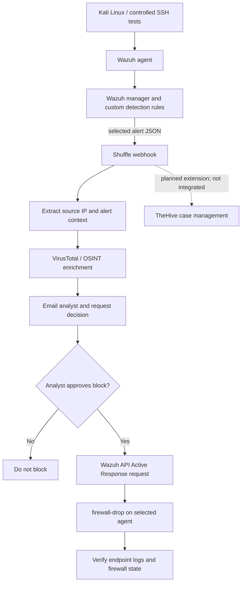

# Workflow Design and Validation

## Implemented workflow

The core workflow is implemented and the Wazuh API dispatch step has a successful execution screenshot in `../assets/screenshots/02-wazuh-active-response-result.png`. That captured response returned HTTP `200`, one affected item, zero failed items, and `AR command was sent to all agents`.

**TheHive limitation:** I was not able to integrate TheHive case creation into the final workflow because of hardware/resource limitations. It remains a planned extension in the architecture and is not part of the completed implementation.

## Alert fields

The workflow needs the source IP from the actual Wazuh alert. A Wazuh alert often exposes fields such as:

- `agent.id` — agent that raised the alert.
- `agent.name` — monitored endpoint.
- `data.srcip` — source IP when the decoder/rule extracts it.
- `data.dstuser` — target username when present.
- `rule.id`, `rule.level`, and `rule.description` — detection metadata.
- `full_log` — original event text, when included.

Not every event contains a source IP. For example, a generic PAM session-open event may not include the remote client's IP. For IP reputation and blocking, use an event that contains `data.srcip`. Inspect the actual webhook execution and use Shuffle's variable picker rather than copying a field path from an Elasticsearch `_source` wrapper without verifying it.

## Human approval gate

1. Receive a selected Wazuh alert.
2. Validate and normalize the source IP.
3. Enrich the IP with reputation context.
4. Notify the analyst and present an explicit approve/deny choice.
5. Connect the **Yes** output to the Wazuh response action.
6. Ensure the **No** output never calls the block command.
7. Record the decision and execution result for review.

Do not execute containment merely because an alert arrives. Confirm the IP belongs to the suspected source and not the analyst's Windows host, the host-only gateway, DNS, or another infrastructure component.

## Wazuh Active Response

- The `firewall-drop` command must be installed and defined correctly for the target agent operating system.
- Wazuh API authentication must succeed before response requests can be made.
- Target the intended agent explicitly; do not assume the agent that generated the alert is necessarily the endpoint that should receive the block.
- Agent IDs can differ between installations. One captured execution targeted agent ID `004`; older lab notes referred to agent ID `003` for `LINUX-ENDPOINT`. Check `sudo /var/ossec/bin/agent_control -l` on the manager and use the current ID for the intended endpoint.
- A successful API result confirms dispatch at the API level. Verify `active-responses.log` and the firewall state on the target endpoint before claiming the IP remained blocked.
- A rule-triggered automatic response can bypass Shuffle approval. Do not leave a broad automatic `firewall-drop` response enabled if all blocking must wait for approval.

## Test evidence

- `../assets/screenshots/01-shuffle-runtime-alert.png` shows the SSH brute-force alert context entering Shuffle, including custom rule ID `100003`.
- `../assets/screenshots/02-wazuh-active-response-result.png` shows the successful Wazuh API dispatch response. The captured request URL references agent ID `004`; verify that this is still the right agent before retesting.
