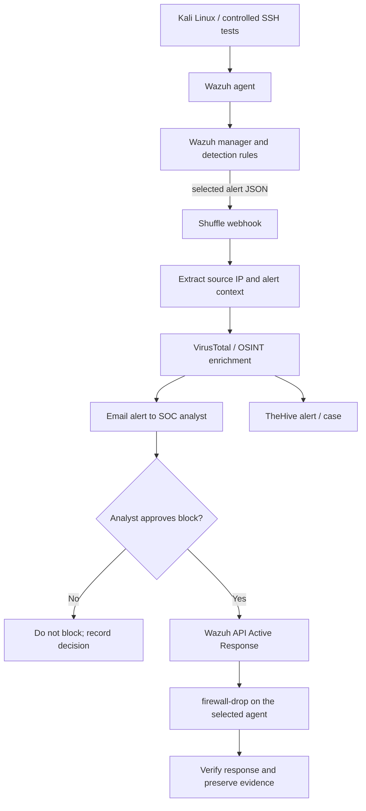

# Workflow Design

## Intended flow

The diagram represents the intended design. Keep the real implementation status in the root README up to date: the notification/approval stage has been reached, while the post-approval action and TheHive case-creation path require final validation.

## Alert fields

The workflow needs the source IP from the actual Wazuh alert. In the alert shared during troubleshooting, the fields were under the Wazuh alert's `_source` object in the indexer result, but the raw Shuffle integration payload may expose alert fields at the top level. Inspect the actual webhook execution payload and use Shuffle's variable picker rather than assuming a path.

Common Wazuh alert fields in this lab include:

- `agent.id` — the agent that raised the alert.
- `agent.name` — the monitored endpoint.
- `data.srcip` — source IP when the decoder/rule extracts it.
- `data.dstuser` — target username when present.
- `rule.id`, `rule.level`, and `rule.description` — detection metadata.
- `full_log` — original event text, where included.

Not every event contains a source IP. For example, a generic PAM session-open event may not contain the remote client's IP. For an IP-reputation or IP-blocking workflow, select an event that actually contains `data.srcip`.

## Human approval gate

1. Receive a selected alert.
2. Validate and normalize the source IP.
3. Enrich the IP with reputation context.
4. Notify the analyst and present a clear approve/deny choice.
5. The **Yes** output alone should connect to the Wazuh response action.
6. The **No** output must not call a block command.
7. Log the decision and execution result for later review.

Do not execute containment merely because an alert arrives. Confirm the IP belongs to the suspected source and not to the analyst's Windows host, the host-only gateway, DNS, or another infrastructure component.

## Wazuh Active Response notes

- The `firewall-drop` command must be installed and defined correctly for the target agent operating system.
- The Wazuh API authentication must succeed before response calls can be considered.
- Target the intended agent explicitly; do not assume the agent that generated the alert is necessarily the endpoint that should receive the block.
- The `active-response` stanza in the original troubleshooting conversation included `<timeout>no</timeout>`. Review and correct that configuration rather than publishing it as a working example. A rule-triggered automatic response can bypass the Shuffle approval gate, so avoid a separate broad automatic response if the project requires human approval.
- A successful API response alone does not prove the firewall rule was applied. Verify the endpoint's Active Response logs and firewall state.
